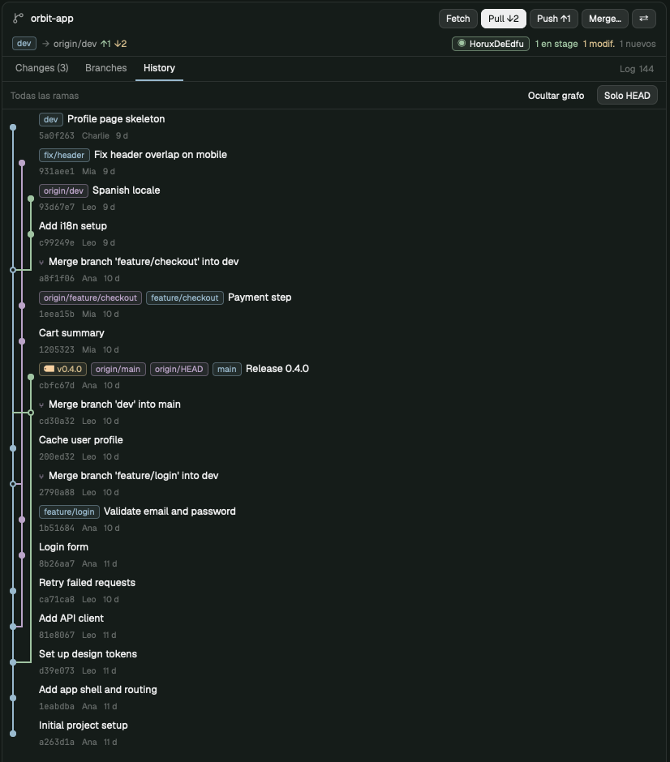

# herdr-mods

Mods for [Herdr Desktop](https://herdr.dev) that turn its right panel into a small code workspace for working alongside coding agents:

- **Git panel** (`mods/git-panel`): a compact Git client next to Files and Changes. Changes, Branches and History tabs; merges with a real conflict simulation before anything runs, which say when a fast-forward will leave no merge commit and remember the merge mode per repository; pull, push, cherry-pick, revert, conflict resolution, worktrees; a per-project account switcher for people with more than one GitHub account; and a log of every command it ran. It refreshes on its own when an agent commits or moves branches, even from another worktree. It never stashes, resets, cleans or force-pushes.
- **Files editor** (`mods/code-files`): the Files panel with editing, unsaved drafts and diffs. The Git panel uses it to open files and to warn about unsaved edits before a checkout or merge. Tabs without edits follow the disk; when an edited tab's file changes under it (a branch switch, a merge) and its unsaved text is a version Git already stores, the bar says reloading loses nothing and offers **Reload** as a safe one-click action instead of "discard your changes?". Real edits keep the usual red bar.
- **Spaces list** (`mods/git-spaces`): Herdr's spaces sidebar, plus **●n**, the number of files with uncommitted changes in each space's worktree, next to the ↑ahead ↓behind commits it already shows. A space with a merge, rebase, cherry-pick, revert or bisect stopped in it, or with conflicted files, shows a red **⚠ merge·2** (operation · conflicts), so you see it without opening the Git panel there.
- **Tab bar** (`mods/git-tabs`): Herdr's tab bar with a **Git** button.
- **Layout** (`layouts/main-code.json`): Herdr's main layout with all four wired in.



The panel's interface is in Spanish. Tested with herdr-app 0.1.15 on macOS.

## Install

```sh
git clone https://github.com/HoruxDeEdfu/herdr-mods ~/herdr-mods
~/herdr-mods/install.sh
```

The script:
- copies the four mods to `~/.config/herdr-app/mods/` and the layout to `layouts/`;
- backs up anything it would replace to `~/herdr-mods-backups/<date>/`;
- keeps the editor's unsaved drafts and your saved accounts;
- runs `herdr-app check` on each mod;
- switches Herdr to the `main-code` layout (`--no-switch` to skip).

Herdr picks the changes up live. If something breaks, `ctrl-alt-shift-escape` returns to the default layout.

You can also install from herdr.dev: ask your agent to add this repo, or build the Git panel from [`RECIPE.md`](RECIPE.md).

### Requirements

- `git` 2.38 or newer (2.40 for the cherry-pick/revert preview).
- Optional: [GitHub CLI](https://cli.github.com) (`gh`) for the per-project account switcher.

## What it touches

- Runs `git` (and `gh`, only for accounts) on the repository of the focused pane. Network access only through Git's own fetch, pull and push.
- Reads files inside the repository and the editor's drafts file.
- Writes to a repository's `.git/config` only when you pin an account to it, and removes exactly that when you unpin.

## Keep your copy in sync

After changing something in Herdr:

```sh
~/herdr-mods/export.sh
cd ~/herdr-mods && git add -A && git commit -m "Describe the change" && git push
```

## Tests

```sh
node --test ~/herdr-mods/tests/*.mjs
```

They test the installed copy in `~/.config/herdr-app/mods/git-panel` against throwaway repositories, with a fake `gh`.

## Uninstall

1. Switch back to Herdr's layout: `herdr-app do layout.switch --name main`.
2. Delete `~/.config/herdr-app/mods/{code-files,git-panel,git-spaces,git-tabs}` and `~/.config/herdr-app/layouts/main-code.json`.

## When Herdr updates

`code-files`, `git-spaces` and `git-tabs` are modified copies of Herdr 0.1.15's `files`, `spaces` and `tabs` mods. If a newer Herdr changes those mods or their API, `install.sh` reports it through `herdr-app check`; clone the originals again (`mod.clone`) and reapply the changes.

## License

Apache 2.0. See [LICENSE](LICENSE) and [NOTICE](NOTICE): parts are derived from Herdr's own mods.

Made by [Charlie Herrera](https://falcux.com).
