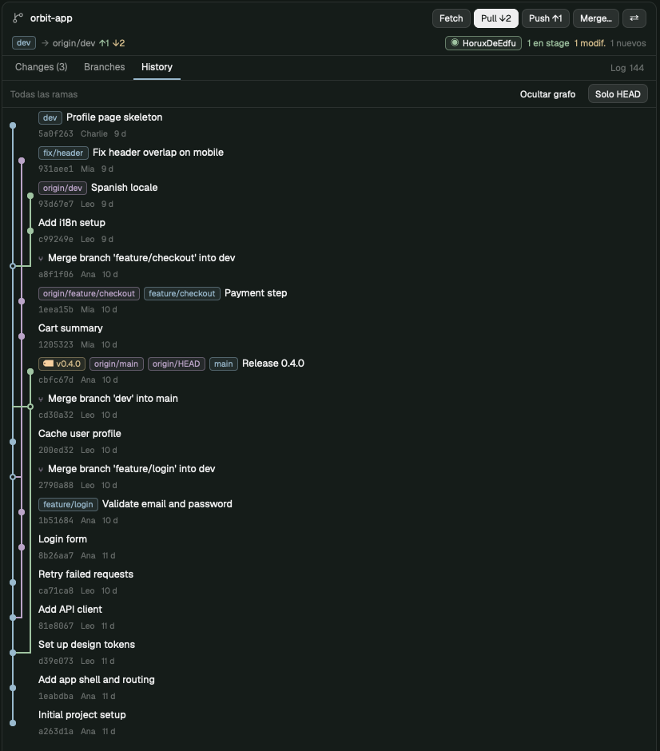

# Git panel

A compact Git client in Herdr's right panel, next to Files and Changes. It shows the repository of the focused pane. It is designed for working with agents:
- it refreshes by itself when an agent changes files, makes commits or moves branches, even from another worktree;
- every risky operation goes through a preview and a confirmation;
- it never runs stash, `reset --hard`, `clean` or force push.

It has three tabs (Changes, Branches and History). Merges can be started from the current branch or from the menu of any other branch, and conflicts are simulated before running them. It also includes cherry-pick, revert, conflict resolution, worktrees and a log of every command it ran. The interface is in Spanish; quoted labels are kept as they appear in the panel.

## What you see

The panel fills its whole block (tested between 320 and 900 px wide). It is a card with 10 px corners, a `background` fill and a 1 px `border`, like Herdr's Changes panel. From top to bottom:

1. **Header** (40 px + 26 px):
   - First line: branch icon (`git-branch.svg`, 15 px, `muted`), repository name (the root folder, in semibold) and the pills `worktree` (`ansi5`) if it is a linked worktree and `fijado ×` ("pinned ×") (`accent`) if the panel is pinned to a worktree. On the right, a spinner while loading and a button bar 24 px high, like Fork's: **Fetch**, **Pull ↓n**, **Push ↑n**, **Merge…** and **⇄** (compare). Pull and Push act on the current branch and only show the number if there is something to fetch or publish; in that case they are highlighted (`solid` / `solid_foreground`). Push says **Publicar** ("Publish") if the branch has no upstream. Below 460 px they are compacted (`↻`, `↓n`, `↑n`).
   - Second line (11.5 px, `muted`): pill with the current branch (`accent`), or `HEAD desacoplado · <sha>` ("detached HEAD") (`blocked`); `→ upstream ↑a ↓b` (↑ in `ansi2` and ↓ in `ansi3` when they are greater than zero), and on the right the working tree state: `✓ limpio` ("clean") (`ansi2`) or `n conflictos` ("conflicts") (`blocked`), `n en stage` ("staged") (`ansi2`), `n modif.` ("modified") (`ansi3`) and `n nuevos` ("new") (`dim`).
   - If an operation is in progress, a red strip appears (`blocked` at 18 %): "Merge en curso · n archivo(s) en conflicto" ("Merge in progress · n file(s) in conflict") with the buttons **Ver** ("View"), **Continuar** ("Continue") (cherry-pick, revert and rebase) and **Abortar …** ("Abort …") (`blocked`). A rebase reads "Rebase de `<rama>` sobre `<base>` · n/m" (from `rebase-merge/` or `rebase-apply/`: `head-name`, `onto` named with `name-rev`, `msgnum`/`end`). A bisect shows **Terminar bisect** ("End bisect", `git bisect reset`).
   - While a write is running: spinner and "Merge feature → main…" in `working`.
2. **Tabs** (31 px): `Changes (n)`, `Branches` and `History`, underlined with 2 px `accent` when active. On the right, `Log n` opens the operation log.
3. **Body**: the active tab, or a **sheet** that replaces it (confirmations, merge preview, diffs). There are no dialogs that cover the whole window. Sheets have a 38 px title with ×, scrollable content and a footer with the buttons aligned to the right.
4. **Notices:** successes and information appear as native Herdr notifications (`notify`, 4 s). Warnings (⚠) and errors (⛔) are shown in a bottom strip with a tinted background and stay until they are closed.

**Changes:**
- Groups Conflictos ("Conflicts"), En stage ("Staged"), Modificados ("Modified") and Sin seguimiento ("Untracked"), with 10.5 px uppercase titles and "Stage todo" / "Unstage todo" ("Stage all" / "Unstage all") on the right.
- 26 px rows: colored status letter (A `ansi2`, D `ansi1`, M `ansi3`, R `ansi5`, U `blocked`, ? `dim`), folder in `dim` + name, `+n` / `−n`, and the buttons ↗ (open in Files) and + / − / ✓.
- The pill `sin guardar` ("unsaved") (`accent`) marks a file with unsaved changes in the editor.
- When a file is selected, the list takes at most 38 % and the diff appears below it: a virtual list of 18 px rows in monospace font at 11 px, two line number columns, `+` on `ansi2` at 11 % and `-` on `ansi1` at 11 %.
- For a text diff of a modified file (work tree or stage, not new, deleted, renamed or binary files, and not on another machine), a 30 px bar above the diff: `‹` **Fragmento n de m** `›` and **Stage fragmento** (primary) or, in the staged diff, **Unstage fragmento**. The selected hunk's `@@` row is tinted `accent` at 20 %; clicking a `@@` row selects it (`on_item_click` on the list), ‹ › scroll to it. It writes a patch of that hunk (file header + hunk) to `<git dir>/herdr-git-panel-hunk.patch` (`exec` has no stdin) and runs `git apply --cached --whitespace=nowarn [--reverse] <patch>`: only the index changes. The diff is read again right before; if it changed, nothing is applied.
- At the bottom, the commit bar: message field (30 px) + **Commit (n)**.

**Branches:**
- Filter field with a magnifying glass and a **+ Nueva** ("+ New") button.
- Virtual list of 28 px rows with collapsible groups:
  - WORKTREES (only if there is more than one; path with `~`, cut at the start);
  - LOCALES ("LOCAL");
  - one group per remote;
  - TAGS (collapsed by default).
- Each branch shows:
  - ● `accent` and name in semibold if it is the current one; ◆ `ansi5` and a `worktree` pill if it is open in another worktree;
  - ↑ / ↓ relative to its upstream;
  - the subject of the last commit (only at 470 px or more);
  - the short hash, at 10.5 px in monospace.
- With a branch selected, a 38 px bottom bar shows its name and the buttons **Cambiar** ("Switch") and **Acciones ⋯** ("Actions ⋯").

**History:**
- Top bar: "Desde main" ("From main") or "Todas las ramas" ("All branches"), **Grafo** ("Graph") / **Ocultar grafo** ("Hide graph") and **Todas las ramas** / **Solo HEAD** ("HEAD only").
- Virtual list of 44 px rows:
  - on the left, the graph: 11 px lanes, 2 px vertical segments and horizontal joins at mid height, with colors `accent`, `ansi5`, `ansi2`, `ansi3`, `ansi6` and `ansi1`. Each commit is an 8 px dot; if it is a merge, the dot is hollow;
  - then the ref pills (HEAD `accent`, local `ansi4`, remote `ansi5`, tag `🏷` `ansi3`) and the subject;
  - below, the short hash, the author and the relative time.
  - a commit where a local branch was before a recent fast-forward (read from that branch's reflog: `merge X: Fast-forward`, `pull …: Fast-forward`, `fetch . refs/remotes/…: fast-forward`; up to 3 per branch, last 30 days) gets a pill `← <rama> antes del ff` (`ansi6`), since a fast-forward leaves no commit of its own.
- Selecting a commit opens a detail view (maximum 260 px, `chrome` background) with the full hash, author, date, full message, for a pre-fast-forward commit the line "main estaba aquí antes del fast-forward de dev y avanzó a `<sha>` sin commit de merge. (`<time>`)", the buttons **Cherry-pick en main…** ("Cherry-pick onto main…"), **Revertir…** ("Revert…") and **⋯**, and the file list (click = diff).

**Context menu:** native popup of 300 px next to the pointer. Dimmed title, 30 px rows, 1 px separators, dangerous actions in `blocked` and disabled ones in `dim`, with an explanation in the tooltip.

## How it behaves

- **Which repository it shows:**
  - It follows the `cwd` of the focused pane, like Herdr's Changes.
  - "Ver este worktree en el panel" ("View this worktree in the panel") **pins** it to another worktree until `fijado ×` is clicked.
  - If the folder is not a repository, it shows an empty state with that path.
- **Refresh:**
  - `watchFolder` on the worktree root and, if the git dir is outside it, also on the `git-common-dir`, where the refs shared by all worktrees live.
  - Events are grouped for 400 ms and `*.lock` files are ignored. There is at most one refresh every 1.5 s.
  - Timer fallback: 10 s locally, 20 s on another machine and 60 s if the panel is hidden. Hidden, watcher events still refresh it at most every 5 s (for the tab bar's badge).
  - Branches and history are only reloaded if the refs fingerprint changed.
  - Selections are identified by ref name, hash or path, so they survive refreshes.
- **Merge, two entry points with the same logic:**
  - A. **Merge…** → choose the source → preview → **Fusionar S en D** ("Merge S into D"). No checkout.
  - B. In the menu of branch T: **`Fusionar <actual> → T…`** ("Merge <current> → T…") →
    1. check the checkout (blocks if there is an operation in progress, conflicts, the branch is in another worktree or there are unsaved files in the editor);
    2. confirmation;
    3. `git switch --no-guess T`;
    4. verify that HEAD is T;
    5. preview;
    6. second confirmation.
  - If T is in another worktree, **"Merge en ese worktree"** ("Merge in that worktree") is offered: the panel pins itself there and does the merge without a checkout.
  - In the same menu, **`Fusionar T → <actual>…`** integrates T into HEAD without switching branches. The labels are short, with the arrow from source to destination; the tooltip explains whether there is a checkout.
- **Sync from a branch's menu:** on the current one, **Pull ↓n** and **Push ↑n**. On another one, **Actualizar ↓n** ("Update"): fetch and then `git fetch . refs/remotes/<upstream>:refs/heads/<rama>`, which only advances if it is a fast-forward and does not touch HEAD, the working tree or the stage. It blocks if the branch diverged (it offers to switch to it to do a Pull) or is in another worktree. Also **Push ↑n** of that branch, without switching branches.
- **The preview shows:**
  - source → destination;
  - whether the merge will be fast-forward or divergent (with the commits on each side);
  - the `git merge-tree --write-tree` simulation: list of conflicts, or "la simulación no encontró conflictos" ("the simulation found no conflicts");
  - sync with the upstreams;
  - incoming commits (maximum 25 shown);
  - affected files (maximum 40);
  - the mode (`--ff`, `--no-ff`, `--ff-only`; only when a fast-forward is possible), with one line under it saying what the graph will show: with `--ff`/`--ff-only`, "`<target>` avanzará a `<sha>`, sin commit de merge: en el grafo (aquí o en Fork) parecerá que no pasó nada. Elige "Siempre crear commit de merge" si quieres verlo."; with `--no-ff`, that a merge commit will be created and stay visible. The mode starts on the one last confirmed in that repository (`localStorage`, key `merge-mode:<machine>:<git-common-dir>`, shared by its worktrees), with the note "Modo recordado de tu último merge en este repositorio." Pull never reads or saves it, and when no fast-forward is possible the mode is always `--ff` (so a remembered `--ff-only` can't fail);
  - the exact command.
  - **Blocks if:** uncommitted changes in files the merge touches, anything staged, untracked files that would be overwritten, unsaved files in the editor, unrelated histories or nothing to integrate.
- **After a fast-forward**, the result sheet adds one line: "`<target>` avanzó a `<sha>`, sin commit de merge; elige "Siempre crear commit de merge" si quieres verlo en el grafo." Without it, clients like Fork look as if nothing happened.
- **Before running**, everything is recomputed. If any SHA or the state changed (for example, an agent made a commit), it does not merge: it shows the updated preview with the notice "El repositorio cambió…" ("The repository changed…").
- **Every confirmation is bound to the repository** (root and machine) it was opened in. Switching space or pane never redirects the action.
- **Conflicts:**
  - The merge result shows the files in conflict and leads to Changes; the header keeps the notice of the operation in progress.
  - Click on a file in conflict: the file with its `<<<<<<<` / `=======` / `>>>>>>>` blocks; your side (ours) on `ansi4`, the incoming side (theirs) on `ansi5`.
  - Options: **Abrir en Files** ("Open in Files"), **Usar una versión entera** ("Use a whole version") (with confirmation: `checkout --ours/--theirs` + `add`) or **Marcar resuelto ✓** ("Mark resolved") (asks for confirmation if markers remain).
  - Commit with an empty message during a merge = `commit --no-edit`, which concludes the merge.
  - **Continuar** = `-c core.editor=true cherry-pick|revert|rebase --continue`. If the rebase stops again at a later commit, it says so (warning) and goes to Changes instead of reporting an error; a commit left empty after resolving gets a sentence suggesting abort or `git rebase --skip` from the terminal (the panel never skips commits).
  - **Abortar** = `merge|cherry-pick|revert|rebase --abort` or `bisect reset`, always with confirmation that names the command and what each one restores.
  - Continue and abort rewrite files, so unsaved editor files in the worktree block them (not for bisect). Both re-read the repository right before running.
  - In a rebase the sides swap: "ours" is the base being rebased onto ("main (base del rebase)") and "theirs" is "tu commit de `<rama>`". The conflict view and "Usar una versión entera" use those labels.
- **Pull** = fetch of the upstream and then, as in Fork:
  - if there is nothing to integrate, only a notification (`notify`, info level);
  - if it is a fast-forward with no blockers and no warnings other than non-conflicting local changes, it is recomputed and `merge --ff-only` is run directly, with a success notification;
  - in any other case, the merge preview with the upstream as the source.
  Push with nothing to publish also only notifies.
- **Push:**
  - Sheet with the commits being published and the command. If there is no upstream: `--set-upstream`.
  - Blocks if the branch is behind its upstream or there is nothing to publish.
  - If the remote rejects it, it explains why and offers **Pull…**. Never `--force`.
- **Cherry-pick / Revert** (right-click on a commit or the detail buttons):
  - Preview with `merge-tree --merge-base` (requires Git ≥ 2.40).
  - Blocks if the commit is already included, if its result would be empty (simulated tree = HEAD's tree), if the revert is of a commit that is not on the branch, if there are overlapping local changes or anything is staged, or if another operation is in progress.
  - On merge commits it uses `-m 1` and explains it.
- **Branches:**
  - Create (validating with `check-ref-format --branch`; option "Cambiar a la nueva rama" ("Switch to the new branch")).
  - Rename.
  - Delete with `-d`. If the branch has unmerged commits, it asks for a second confirmation for `-D`.
  - If the branch has an upstream that still exists, the delete sheet first fetches that remote and offers an **unticked** checkbox "Eliminar también `origin/x` del remoto". It is disabled, with the reason, when `origin/x` is the remote's default branch or when commits exist only in the local branch and/or its upstream (`rev-list --count <local> <upstream> --not --exclude=… --all`): `git branch -d` accepts a branch merged only into its upstream, so deleting both would orphan them. Ticked, the local branch goes first (`-d`); only if that worked, `ls-remote` checks the remote didn't move and nothing would be orphaned, then `git push <remote> --delete refs/heads/<x>`. The notification says what was deleted and what wasn't (warning level if the remote stayed). The `-D` path never touches the remote.
  - Create a local branch that tracks a remote one.
  - **Delete a branch on its remote** (menu of a remote branch, `Eliminar origin/x del remoto…`, in `blocked`): a sheet that first fetches that remote (logged), then shows the branch's commit and: a block if it is the remote's default branch (`refs/remotes/<remote>/HEAD`; then no warnings); warnings for local branches that track it (they stay) and for everyone using the remote; and, when commits exist only there (`rev-list --count <ref> --not --exclude=<ref> --all`), a required checkbox "Entiendo que esos commits dejarán de estar en el remoto". Right before running, `git ls-remote --heads <remote> refs/heads/<x>` (logged, no prompts): if the branch moved since the sheet opened it refuses with both hashes; if it is already gone it says so. Then `git push <remote> --delete refs/heads/<x>` — not a force push; local branches never change.
- **Worktrees:**
  - In Herdr's folder: `~/.herdr/worktrees/<repo>/<rama saneada>`.
  - Create from a branch or from a commit.
  - Open in a space (`space.new {folder}`).
  - Remove with `git worktree remove` (without `--force`; never the main one nor the current one).
  - Prune those that lost their folder.
- **Fetch:** one remote, or `--all` if there are several. Never `--prune` unless asked.
- **Automatic fetch (opt-in):** right-click **Fetch** → menu "Fetch automático": **Desactivado** (default), **Cada 5 / 15 / 30 minutos** (`localStorage` `autoFetch`). When on, the button reads `Fetch · 15m` (`↻·15` when narrow) and its tooltip says when the last one ran. It fetches only the repository the panel shows, when no other operation runs, counting from when the panel first shows that repository (switching spaces doesn't fetch them all); enabling it fetches the current one at once. Same command as Fetch (logged, `GIT_TERMINAL_PROMPT=0`, no `--prune`), without a success notification. A failure pauses it for that repository with one warning; a manual Fetch that works resumes it.
- **No prompts:** every network command runs with `env GIT_TERMINAL_PROMPT=0` (on local Windows, `-c credential.interactive=never`). If credentials are needed, it fails with the message "El remoto pidió credenciales…" ("The remote asked for credentials…").
- **Errors:** Git's stderr is translated into a sentence with an action (index lock, files that would be overwritten, branch in another worktree, unmerged branch, credentials, network, timeout, …). The original text stays in the Log.
- **Log:** every write and every failed read, with time, duration, exit code, folder, the exact command (quoted if needed) and its stderr. Maximum 200 entries, stored in `localStorage`.
- **Mouse:**
  - Branches: click selects; double click (within 450 ms) switches to the branch, with confirmation; right click opens the menu.
  - Changes files: double click opens in Files.
  - Commits: click opens the detail.
- **Keyboard** (with the panel focused and outside the fields):
  - `1` `2` `3`: tabs.
  - `↑↓` / `j` `k`: move through the list.
  - `Enter`: branch actions or commit detail.
  - `Espacio` (Space): commit menu.
  - `/`: filter.
  - `f`: Fetch. `m`: Merge. `g`: graph.
  - `Esc`: close or go back. `"focusable": true` allows reaching it with `pane.go`.

**Account per project** (for people who work with more than one GitHub account):
- On the second line of the header, before the status, an 18 px pill with the account that will push: `○ login` (`muted`) if it comes from `gh`'s global account, `◉ login` (`ansi2`) if it is pinned to this project and `⚠ login` (`ansi3`) if the author's email belongs to another account. The tooltip shows the push account, its origin and the author (`name <email>`).
- Click → menu: **Fijar este proyecto a `<login>`…** ("Pin this project to `<login>`…") for each `gh` account on the remote's host, **Quitar la fijación** ("Remove the pin"), **Cuenta global de gh → `<login>`…** ("Global gh account → `<login>`…") (with confirmation: it affects all unpinned projects) and **Volver a leer las cuentas de gh** ("Re-read gh accounts").
- Pinning opens a sheet with the author's name and email (remembered per account in `mods/git-panel/.accounts.json`) and the list of what changes. It writes only to the repository's `.git/config`: `user.name`, `user.email`, an empty credential helper (clears the inherited list) followed by one that asks `gh` for that account's token (`gh auth token --user <login>`), and the `[herdr-git-panel]` section with the account and what was there before. Removing the pin deletes exactly that and restores the repo's own name or email, if it had any.
- It never replaces a helper the person set by hand, unless it is of the same kind (`auth token --user`), which counts as a pin. With an SSH remote it only pins the author: the key decides the account.
- The Push sheet shows "Push con `<login>`" ("Push with `<login>`") and the author, with a warning if they do not match. Under the commit field, "Autor: nombre <correo>" ("Author: name <email>") (click → the same menu).

## Built from

- **Layout** (the user's, cloned from `main`):
  - In the `panel-body` stack, next to `files` and `changes`, a block `{ "id": "git", "type": "block", "content": { "mod": "git-panel", "props": { "block": "git" } } }`. `props.block` is the id the mod looks up in `layout()` to know whether it is visible (and refresh less if not).
  - The `tabs` block uses `git-tabs`.
- **`mods/git-spaces/`**: `mod.clone {name: "spaces", as: "git-spaces"}`. For each listed worktree it also runs `status --porcelain -z --untracked-files=all` (●n, `ansi3`; unmerged entries count as conflicts) and `rev-parse --git-path` for the in-progress markers (`MERGE_HEAD`, `CHERRY_PICK_HEAD`, `REVERT_HEAD`, `rebase-merge/head-name`, `rebase-apply/head-name`, `BISECT_LOG`, checked with `readTextFile`). An operation or conflicts show `⚠ <op>·<n>` in `blocked` before ●n, with a tooltip. The parsing lives in `gitstate.js`, with no Herdr imports, so it is tested with Node.
- **`mods/git-tabs/`**: `mod.clone {name: "tabs", as: "git-tabs"}`, with two changes. It adds `"git"` to the list of enabled panels (`shared("workspace.panels")`), so it is remembered per space like Files and Changes. It adds a **Git** button with `mods/git-panel/git-branch.svg` that runs `layout.select {stack: "panel-body", child: "git"}` + `layout.show {id: "panel"}` (only if a `git` node exists). Next to "Git", a 15 px badge read from the shared `"git-panel.summary"` (`{root, on, total, conflicts, op, head}`, written by the panel copy that has `props.block`, only when it changes): the number of uncommitted files in `ansi3`, or `⚠n` in `blocked` for an operation in progress or conflicts, with a tooltip (`badge.js`, tested with Node). So the badge doesn't lag while the panel is hidden, the panel also refreshes on watcher events when hidden, at most every 5 s.
- **`mods/git-panel/`** (`mod.json`: `{ "place": "none", "focusable": true }`):
  - `git/runner.js`: `exec("git", argv[])`, never a shell string. Reads carry `--no-optional-locks -c core.fsmonitor=false -c diff.autoRefreshIndex=false -c core.quotePath=false -c color.ui=false` so they do not write to `.git` (if they wrote, they would trigger the watcher in a loop and lock the index for the agents). Write queue per `git-common-dir`. Every write and every unexpected exit code is recorded in the log. It supports "expected" exit codes (for example, `merge-tree` returns 1 when there are conflicts).
  - `git/parse.js`: `status --porcelain=v2 --branch -z`, `for-each-ref` with `%1f`/`%1e` separators (includes `%(worktreepath)` and `%(upstream:track,nobracket)`), `worktree list --porcelain -z`, `log -z --topo-order`, `--name-status -z` and `merge-tree`.
  - `git/queries.js`, `git/ops.js`, `git/merge-flow.js` (checkout, merge preview, pick, push and pull, worktree paths, editor drafts), `git/diff.js` (diff and conflict rows) and `git/graph.js` (lanes). All are pure and tested with Node.
  - `ui/panel.js`, `ui/sheets.js`, `ui/diffview.js`, `ui/menu.js` and `ui/kit.js`: everything with colors from `theme()`.
  - The context menu is `openOverlay({ mod: "git-panel", kind: "popup", width: 300, props: { menu } })`. The popup copy returns the choice with `setShared("git-panel.pick", { owner, nonce, id })`; only the panel copy with that `owner` runs it.
  - `git/accounts.js`: accounts from `gh auth status --json hosts` (cached for one minute), remote host, effective author (`git config --show-scope`), pin and unpin. Pure and tested with a fake `gh`.
- **`herdr` functions:** `exec`, `readTextFile`, `watchFolder`, `spaces`, `panes`, `focused`, `layout`, `theme`, `settings`, `home`, `appHome`, `window`, `props`, `shared`, `setShared`, `openOverlay`, `closeOverlay`, `nextCommand` (`focus`, `fetch`, `merge`) and `run` (`layout.select`, `layout.show`, `space.new`).
- **Optional editor integration** (`code-files.open` protocol):
  - **Open:** `setShared("code-files.open", { path, on, nonce, at })` after showing Files. An editor that wants to receive it checks in its `render`: new `ask.nonce` and `Date.now() - ask.at < 15000` → opens `path` and sets the value to `null`.
  - **Unsaved files:** the panel reads (without writing) `mods/code-files/.drafts/drafts.json` (`{ [absolute path]: { text, baseline } }`). A draft **only blocks** if its text is not equal to the file on disk **and** Git has no blob with that content. This is checked with `sha1("blob <bytes>\0" + bytes)` and `git cat-file -e`, run from the repository root. If the content is already in Git (another branch open in the editor after a checkout), it only warns.
  - Without a compatible editor, ↗ shows Files and drafts do not count.
  - On the editor's side (`code-files`, `gitblob.js`), the same blob check runs when an edited tab's file changes on disk: if `git cat-file -e <blob of the tab's text>` succeeds (run in the file's folder), the conflict bar turns `accent`, says the text is a version Git already stores, and **Reload** is primary and skips the "discard your changes?" question. It never reloads by itself, and a text Git doesn't have keeps the red bar.
- **Programs:** `git` (≥ 2.38 for `merge-tree --write-tree`; ≥ 2.40 for simulated cherry-pick and revert) and `env` on macOS and Linux. It reads files inside the repository and the editor's drafts file, and only Git uses the network (fetch, pull and push).

- **Accounts:** `gh` (GitHub CLI) is optional: without it, the pill shows only the author.

## Watch out

- **Virtual lists do not support per-row handlers.** An `on_click` or `on_mouse_down` inside the `v_virtual_list` renderer leaves the list **blank with no error**. Use `on_item_click(key)` and `on_item_secondary_click(key, event)` on the list, with stable keys (ref name, hash, `wt:<path>`, `g:<group>`). For double click, compare two clicks within 450 ms on the same key. You also cannot call `cx.notify()` or `spawn` inside the renderer: progressive history loading only records `range.end`, and the timer or `on_scroll_wheel` request the next page.
- `flex_shrink(n)` needs its number: without it, it fails only when painting ("expected a number, got nil").
- **The panel follows the focused pane.** If each confirmation is not bound to its repository, switching space between "confirm" and "run" would act on another repo. Each sheet stores `{cwd: root, on}` and execution checks that the root did not change.
- **macOS uses symbolic links** (`/tmp`, `/var` → `/private/…`). Git returns the real path and the editor the pane's path. Compute the alias with `rev-parse --show-prefix` and compare against both.
- `git diff` of a file in conflict is a combined diff (`@@@`) that a normal parser does not understand: show the file with its markers instead of that diff.
- The folder of the file in conflict may not exist on the current branch: any `exec` with `cwd` must use the repository root.
- `merge-tree` returns 1 when there are conflicts, and `merge-base` and `rev-parse --verify` return 1 when the answer is "no". Mark them as expected or the log fills with false errors; the same goes for "not a git repository" (128) while another space is focused.
- `git log %s` joins the lines of the first paragraph: for there to be a body, the message needs a blank line.
- If `git push` is run with the explicit `<rama>:<rama>` branch, it never pushes another branch by accident.
- Limits: Changes shows 1000 files; diffs are cut at 6000 rows; history loads 200 at a time (navigating from a branch searches up to 5000 commits); the graph draws 6 lanes; the log keeps 200 entries. Rebase and bisect can be continued/aborted/ended, but not started, skipped or edited from the panel.
- In spaces on another machine (`on`) there is no `watchFolder`: only the timer. The editor is read-only there.
- When testing the panel by driving it from outside, **always pin it to a temporary repository**: if the person switches space in the meantime, the panel moves to their real repo.

- `gh auth git-credential` **always** answers with `gh`'s active account, even if Git passes it another `username`. To pin an account per project you have to write your own helper with `gh auth token --user`, preceded by an empty helper so the global one is not also consulted. Use the absolute path of `gh`: Git runs the helper outside the login shell.

## Done when

- `herdr-app check mods/git-panel` and `herdr-app check mods/git-tabs` pass, and `herdr-app status` shows no errors with the panel open.
- The **Git** button in the top bar shows the panel. After switching to another space and back, the chosen panel is remembered.
- After `git merge dev` fast-forwards `main`, History shows `← main antes del ff` on main's previous commit, and its detail explains it. A `--no-ff` merge adds no such pill.
- In a temporary repository with `main` and `feature/login` ahead: **Merge…** → `feature/login` shows "avanzará n commit(s) (fast-forward posible)" ("will advance n commit(s) (fast-forward possible)"), and on confirming, `main` points to the same commit as `feature/login`.
- After that fast-forward, the result says "main avanzó a `<sha>`, sin commit de merge…". Merging another branch with **Siempre crear commit de merge** leaves a commit with two parents, and the next fast-forward preview in that repository starts on that mode with "Modo recordado…".
- With HEAD on `feature/x`, the menu of `main` → `Fusionar feature/x → main…` asks to confirm the checkout, leaves HEAD on `main` and opens the preview with source `feature/x`. No merge happens without the second confirmation.
- If a commit is made on the source (for example, with `git update-ref`) between the preview and the confirmation, the panel does not merge and shows "El repositorio cambió…" with the new number of commits.
- Two branches that touch the same line: the preview lists the file as a conflict. On merging, the header shows "Merge en curso" and **Abortar merge** ("Abort merge") (with confirmation) returns HEAD to its previous commit and keeps the local changes that were not touched.
- With a branch open in another worktree: its row shows ◆ and `worktree`, the checkout is blocked with the path and "Merge en ese worktree" does it there.
- Changes: + / − move files between groups (including a deletion and a name with ñ and spaces), the diff shows line numbers and Commit creates the commit on the current branch.
- A file with three separate edits: selecting fragment 2 and **Stage fragmento** leaves only that change in `git diff --cached`, the file unchanged; **Unstage fragmento** in the staged diff takes it back out.
- With `qa` 3 commits behind `origin/qa` and HEAD on `main`, the menu of `qa` → **Actualizar ↓3** advances it and leaves HEAD and the files intact; if `qa` also has a commit of its own, it refuses and explains why.
- Deleting local `feature/done` (merged into main, pushed) with the checkbox ticked removes it locally and from the bare `origin`; for `feature/wip` (pushed, not merged) the checkbox is disabled and explains why.
- With a temporary bare `origin`: deleting `origin/old-experiment` (a commit only there) is disabled until the checkbox is ticked, then removes it from the bare repo; `origin/main` is blocked; if a teammate pushes to `origin/feature` after the sheet opened, the panel refuses with "Alguien actualizó…" and deletes nothing.
- Rejected push (the remote has a new commit) shows "El remoto rechazó el push…" ("The remote rejected the push…") and **Pull…**; Pull fetches and opens the preview with `origin/<rama>`.
- History with "Todas las ramas" draws the forks and merges with colored lanes, and `g` hides it.
- A cherry-pick with a conflict can be resolved with "Usar el commit del cherry-pick" ("Use the cherry-pick's commit") and **Continuar**, and ends with a new commit and a clean state.
- `git rebase main` on a branch that conflicts stops: the header shows "Rebase de feature sobre main · 1/n", the conflict view labels main as the base, "Usar tu commit" + **Continuar** finishes the rebase, and **Abortar rebase** (on another stopped rebase) leaves the branch at its original commit.
- The Log shows each of those commands with its exit code.
- In a temporary repository with a remote `https://github.com/...`: pinning account B makes `git credential fill` return `username=B` inside the repo and `gh`'s active account outside it. Removing the pin leaves `.git/config` as it was.
